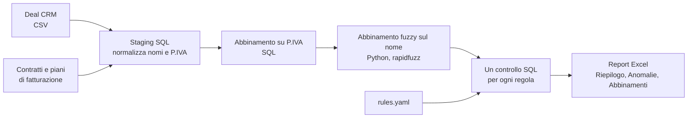

# Riconciliazione CRM e fatturazione

*[Read in English](README.md)*

Ogni azienda che vende con un CRM e fattura con un altro sistema prima o poi si scontra con lo stesso problema: i due non sono mai del tutto allineati. Un deal risulta vinto ma nessuno ha impostato la fatturazione. Un contratto viene fatturato ma il commerciale non l'ha mai registrato. L'importo sul CRM non è quello in fattura. Di solito ce ne si accorge solo quando qualcuno chiede perché due report danno numeri diversi.

Controllare tutto a mano con i CERCA.VERT funziona con cinquanta clienti. Con qualche centinaio non regge più, e salta del tutto quando i nomi sono scritti in modo diverso nei due sistemi.

Questo progetto è una versione piccola ma completa della riconciliazione che costruisco e porto avanti nel mio lavoro di operations data analyst. I dati veri ovviamente restano in azienda, quindi qui tutto gira su un dataset sintetico che riproduce lo stesso tipo di disordine: ragioni sociali scritte in modi diversi, partite IVA in cinque formati, campi mancanti, differenze di arrotondamento.

## Cosa controlla

| Controllo | Cosa significa in pratica |
|---|---|
| `missing_in_billing` | Il cliente ha firmato ma nessuno lo sta fatturando. Fatturato perso. |
| `missing_in_crm` | Stiamo fatturando qualcuno che il CRM non conosce. Pipeline e provvigioni sono sbagliate. |
| `amount_mismatch` | I due sistemi conoscono il cliente ma non sono d'accordo sul prezzo, oltre una tolleranza configurabile. |
| `stage_mismatch` | Il contratto è attivo ma il deal è ancora "in trattativa". La pipeline sembra più grande di quella che è. |
| `no_billing_plan` | Contratto attivo senza nessuna fattura pianificata. |
| `plan_total_mismatch` | Le fatture pianificate non tornano con il valore del contratto. |
| `below_minimum_fee` | Contratto con un canone sotto il minimo previsto dalla politica commerciale. |
| `duplicate_vat` | Lo stesso cliente è stato creato due volte sul CRM. |
| `deal_name_format` | Il nome del deal non segue la convenzione, e questo rompe tutti i report che raggruppano per nome. |
| `missing_vat` | Non è ancora un errore, ma il deal si è potuto abbinare solo per nome. |

Ogni caso esce con una gravità e, quando ha senso, con l'importo coinvolto. Così la lista si ordina in base a quello che costa davvero, invece di leggerla dall'alto in basso.

## Come funziona



Alcune scelte che vale la pena spiegare.

**SQL per la logica, Python per il resto.** Normalizzazione, abbinamento su partita IVA e tutti i controlli sono SQL semplice che gira su DuckDB. Chi conosce SQL legge le regole senza sapere Python, e le stesse query girerebbero con piccole modifiche su SQL Server o Postgres. Python si occupa di quello in cui SQL è scomodo: il confronto fuzzy dei nomi e un file Excel formattato bene.

**Prima la partita IVA, poi il nome.** La partita IVA è la chiave comune più affidabile, quindi si parte da lì. Solo i deal senza una partita IVA valida passano dall'abbinamento sul nome, e solo verso i contratti rimasti liberi. Un abbinamento fuzzy viene accettato solo se è nettamente migliore del secondo candidato. Se due aziende sembrano simili allo stesso modo preferisco lasciare la decisione a una persona piuttosto che tirare a indovinare.

**La normalizzazione è metà del lavoro.** "Rossi Logistica S.r.l.", "ROSSI LOGISTICA SRL" e "rossi  logistica srl" devono diventare la stessa chiave, e lo stesso vale per "IT 01234567890" e "01234 567890". Le lettere accentate (Foà, Boldù) mi hanno fregato la prima volta: venivano segnalate come errori di naming senza esserlo. Adesso c'è un test apposta.

**Le regole stanno in un file di configurazione.** Tolleranza, canone minimo, soglia di abbinamento e formato dei nomi sono in [rules.yaml](rules.yaml). Sono le cose che cambiano quando cambia il business, e chi le decide non dovrebbe dover aprire il codice.

**Testato su una risposta nota.** Il generatore di dati inserisce una lista precisa di problemi e la salva. I test verificano che la riconciliazione trovi esattamente quella lista, senza perderne nessuno e senza inventarne altri. È l'unico modo che conosco per essere sicuro che un controllo del genere funzioni prima di usarlo su dati veri.

## Come si lancia

```bash
pip install -r requirements.txt
python src/generate_data.py     # crea i CSV sintetici in data/
python src/reconcile.py         # esegue i controlli e scrive reports/reconciliation_report.xlsx
python -m pytest                # verifica che ogni anomalia inserita venga trovata
```

Il risultato sui dati di esempio è riportato nel [README in inglese](README.md#run-it), e il file Excel è già nella cartella [reports/](reports/) per chi vuole solo vedere com'è fatto l'output.

## Struttura

```
data/        file sintetici in input e lista delle anomalie inserite
sql/         staging, abbinamento e controlli, nell'ordine in cui girano
src/         generatore di dati e script di riconciliazione
tests/       confronto del risultato con le anomalie inserite
reports/     output Excel
rules.yaml   regole di business
```

## Dai dati sintetici a quelli veri

Nel lavoro di tutti i giorni gli input arrivano dalle API del CRM e da un export della piattaforma di fatturazione invece che da CSV, e l'output alimenta una dashboard Power BI e una mail settimanale oltre al file Excel. La struttura però resta la stessa: normalizzare, abbinare sulla chiave forte, ripiegare sul fuzzy, un controllo per ogni regola, ordinare per impatto.

## Strumenti

Python, DuckDB, SQL, pandas, rapidfuzz, openpyxl, pytest.

Tutti i dati di questo repository sono sintetici e vengono generati da [src/generate_data.py](src/generate_data.py). Le ragioni sociali arrivano da Faker e le partite IVA sono cifre casuali.

## Progetti collegati

Questo repository fa parte di un piccolo portfolio costruito attorno allo stesso tipo di lavoro. La [pagina profilo](https://github.com/messimarco0701) spiega come si incastrano i pezzi.

| Progetto | |
|---|---|
| [crm-api-extractor](https://github.com/messimarco0701/crm-api-extractor) | Estrarre i dati dal CRM |
| [crm-billing-reconciliation](https://github.com/messimarco0701/crm-billing-reconciliation) | Controllarli con la fatturazione |
| [sales-pipeline-analytics](https://github.com/messimarco0701/sales-pipeline-analytics) | Analizzarli con SQL e Python |
| [powerbi-sales-dashboard](https://github.com/messimarco0701/powerbi-sales-dashboard) | Metterli davanti alle persone |
| [ai-contract-extraction](https://github.com/messimarco0701/ai-contract-extraction) | Portare i nuovi clienti nei sistemi |
