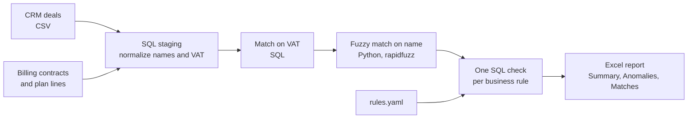

# CRM vs Billing Reconciliation

*[Leggi in italiano](README.it.md)*

Every company that sells with a CRM and bills with a different system ends up with the same problem: the two never fully agree. A deal is marked as won but nobody set up the invoicing. A contract is being billed but the sales team never recorded it. The amount in the CRM is not the amount on the invoice. Most of the time nobody notices until someone asks why the numbers in two reports don't match.

Checking this by hand with VLOOKUPs works for fifty customers. It stops working at a few hundred, and it breaks completely when names are typed differently in each system.

This project is a small, complete version of the reconciliation I build and run in my job as an operations data analyst. The real data obviously stays at work, so everything here runs on a synthetic dataset that reproduces the same kind of mess: inconsistent company names, VAT numbers written in five different ways, missing fields, rounding noise.

## What it checks

| Check | What it means in practice |
|---|---|
| `missing_in_billing` | The customer signed, but nobody is billing them. This is lost revenue. |
| `missing_in_crm` | We are billing someone the CRM doesn't know about. Pipeline and commission reports are wrong. |
| `amount_mismatch` | Both systems know the customer but disagree on the price, beyond a configurable tolerance. |
| `stage_mismatch` | The contract is live but the deal is still "in negotiation". Pipeline looks bigger than it is. |
| `no_billing_plan` | Active contract with no invoices scheduled. |
| `plan_total_mismatch` | The invoices scheduled don't add up to the contract value. |
| `below_minimum_fee` | A contract priced below the commercial policy minimum. |
| `duplicate_vat` | The same customer was created twice in the CRM. |
| `deal_name_format` | Deal name doesn't follow the naming convention, which breaks every report that groups by name. |
| `missing_vat` | Not an error yet, but the deal could only be matched by name. |

Each case comes out with a severity and, where it makes sense, the amount involved. That way the list can be sorted by what actually costs money instead of being read top to bottom.

## How it works



A few choices worth explaining.

**SQL for the logic, Python for the glue.** Normalization, matching on VAT and all the checks are plain SQL running on DuckDB. Anyone who knows SQL can read the rules without knowing Python, and the same queries would run with small changes on SQL Server or Postgres. Python handles what SQL is bad at: fuzzy matching and producing a nicely formatted Excel file.

**VAT first, name second.** VAT number is the most reliable shared key, so it goes first. Only deals without a usable VAT go through fuzzy name matching, and only against contracts nobody else has claimed. A fuzzy match is accepted only if it is clearly better than the second best candidate. If two companies look equally similar, I'd rather leave it to a human than guess.

**Normalization is half the job.** "Rossi Logistica S.r.l.", "ROSSI LOGISTICA SRL" and "rossi  logistica srl" have to become the same key. The same goes for "IT 01234567890" and "01234 567890". Accented letters (Foà, Boldù) caught me out the first time: they were flagged as naming errors when they weren't. There's now a test for that.

**Rules in a config file.** Tolerance, minimum fee, matching threshold and naming pattern live in [rules.yaml](rules.yaml). These are the things that change when the business changes, and the people who decide them shouldn't need to open the code.

**Tested against a known answer.** The data generator plants a precise list of problems and writes it down. The tests check that the reconciliation finds exactly that list, with nothing missed and nothing invented. That's the only way I know to be sure a check like this works before trusting it on real data.

## Run it

```bash
pip install -r requirements.txt
python src/generate_data.py     # creates the synthetic CSVs in data/
python src/reconcile.py         # runs the checks and writes reports/reconciliation_report.xlsx
python -m pytest                # verifies every planted anomaly is found
```

Output on the sample data:

```
Deals: 324   Contracts: 209   Matched on VAT: 197   Matched on name: 10

       anomaly_type severity  cases  amount_at_stake
 missing_in_billing     high     10        88,964.43
     missing_in_crm     high      6        33,920.00
    no_billing_plan     high      5        35,460.00
    amount_mismatch   medium     12        27,002.00
plan_total_mismatch   medium      6        12,380.00
     stage_mismatch   medium      6             0.00
  below_minimum_fee   medium      5         1,800.00
      duplicate_vat   medium      4             0.00
        missing_vat      low     10             0.00
   deal_name_format      low      8             0.00

Total cases to review: 72
```

The Excel file is already in [reports/](reports/) if you just want to see what the output looks like.

## Project structure

```
data/        synthetic input files and the list of planted anomalies
sql/         staging, matching and checks, in the order they run
src/         data generator and reconciliation runner
tests/       checks the result against the planted anomalies
reports/     Excel output
rules.yaml   business rules
```

## Taking it to real data

In my day to day work the inputs come from a CRM API and an export of the billing platform instead of CSV files, and the output feeds a Power BI dashboard and a weekly email instead of just an Excel file. The structure stays the same: normalize, match on the strong key, fall back to fuzzy, one check per rule, sort by impact.

## Stack

Python, DuckDB, SQL, pandas, rapidfuzz, openpyxl, pytest.

All data in this repository is synthetic and generated by [src/generate_data.py](src/generate_data.py). Company names come from Faker and VAT numbers are random digits.

## Related projects

This repository is part of a small portfolio built around the same kind of work. The [profile page](https://github.com/messimarco0701) explains how the pieces fit together.

| Project | |
|---|---|
| [crm-api-extractor](https://github.com/messimarco0701/crm-api-extractor) | Getting the data out of the CRM |
| [crm-billing-reconciliation](https://github.com/messimarco0701/crm-billing-reconciliation) | Checking it against billing |
| [sales-pipeline-analytics](https://github.com/messimarco0701/sales-pipeline-analytics) | Analysing it with SQL and Python |
| [powerbi-sales-dashboard](https://github.com/messimarco0701/powerbi-sales-dashboard) | Putting it in front of people |
| [ai-contract-extraction](https://github.com/messimarco0701/ai-contract-extraction) | Getting new customers into the systems |
